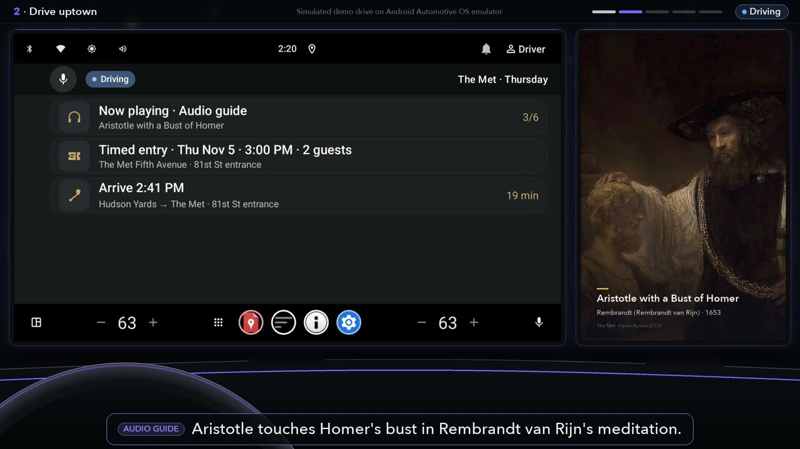
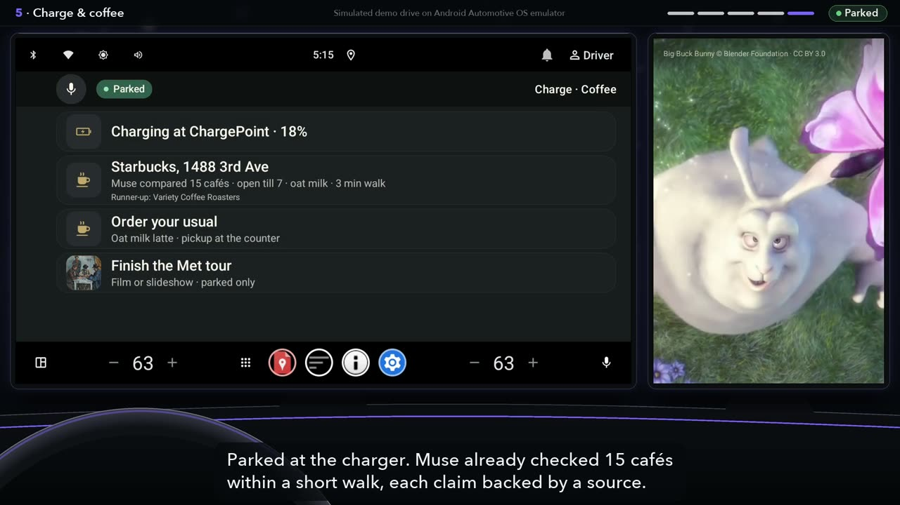

# Muse2CarUI

**Any model can design the screen. The car decides what the driver sees.**

Meta's Muse plans the trip: a cited brief for The Met, an audio guide for the drive, a café picked from 15 it researched.
Android Automotive's own driving restrictions prune Muse's screens per display, fail-closed; bookings and orders wait until
the car is parked and the driver confirms.

Demo video: [Muse2CarUI on YouTube](https://youtu.be/WVbYJ-v_73s) (2:35)




How Muse (`muse-spark-1.3`) is used:
- **Cited brief:** a Responses API `web_search` call with the car's `user_location` returns cited prose, then a structured call
  turns it into the car's UI schema. There are two calls because citations are dropped when search and a JSON schema share one
  (verified 2026-11-04; [adapters.py](tools/a2ui-gateway/a2ui_gateway/adapters.py)). The output, with its sources, is in [BRIEF.json](a2ui-automotive/demo/fixtures/met/BRIEF.json).
- **Researcher and curator:** a cited audio guide for six Met Open Access works ([AUDIO_GUIDE.json](a2ui-automotive/demo/fixtures/met/AUDIO_GUIDE.json)). Fifteen OpenStreetMap cafés,
  each with cited evidence per criterion, ranked by a deterministic script ([COFFEE.json](a2ui-automotive/demo/fixtures/coffee/COFFEE.json)).
- **Voice Transcribe:** the passengers' spoken requests in the video.
- **Muse Code and Muse vision as reviewers:** a deep code review of this branch, and a frame-by-frame review of the demo
  video against what it must not claim. The findings and fixes are in [docs/muse-review/](docs/muse-review/).

- **Every claim cited:** a no-network gate ([check-muse-claims.py](scripts/check-muse-claims.py)) checks Muse's committed outputs:
  67/67 claims carry a source, scores re-add, and the screen's strings match the ranking.

The story beat by beat: [docs/DEMO.md](docs/DEMO.md).

Checks that need no keys:

```bash
python3 -m pip install --require-hashes -r tools/a2ui-gateway/requirements.txt  # jsonschema
python3 -m unittest discover -s tools/a2ui-gateway -p 'test_*.py'  # gateway; replays Muse's brief offline
python3 scripts/test_muse_curate_coffee.py  # café ranking from Muse's recorded answers
python3 scripts/test_run_nyc_demo.py        # recorder timeline and composition (ffmpeg)
```

---

# AAOS Car Libraries — Dart Technologies fork

A standalone Gradle build of AOSP `packages/apps/Car/libs` (`car-ui-lib`, rotary, OEM plugin, media,
telephony, messenger, assist and UX-restriction libraries) with driver-distraction fixes, grown into
an automotive [A2UI](https://github.com/a2ui-project/a2ui) platform: one shared model and policy, two AAOS hosts, a gate.

## Modules

| Module (path) | Output | Role |
|---|---|---|
| `:car-ui-lib` (`car-ui-lib/car-ui-lib`) | AAR | OEM-themeable components; fail-closed, per-display `CarUxRestrictionsUtil` |
| `:car-rotary-lib` (`car-ui-lib/car-rotary-lib`) | AAR | Rotary / non-touch focus |
| `:plugin` (`car-ui-lib/referencedesign/plugin`) | APK | Reference OEM plugin; also replaces the emulator's stale proxy plugin for tests |
| `:PaintBooth` (`car-ui-lib/paintbooth`) | APK | Component gallery |
| `:oem-apis` (`car-ui-lib/oem-apis`) | tests | Contract tests over published `car-ui-lib-plugin-apis:1.5.0` (AAR vendored in `prebuilts/` for Soong) |
| `:car-apps-common`, `:car-apps-common-testutils` | AAR | Shared app widgets (`UxrButton`, `UxrTextView`); test helpers kept out of the production AAR |
| `:car-media-common` | AAR | Media browse/playback, migrated to Media3 |
| `:car-uxr-client-lib` | AAR | UX-restriction content limiting |
| `:car-telephony-common`, `:car-messenger-common` (+ `:model`), `:car-assist-lib` | AAR | Inherited libraries |
| `:car-system-stubs` | compile-only | `@SystemApi` stand-ins for `car-media-common`; never packaged |
| `:a2ui-model` | AAR | A2UI protocol model, restriction/action policy, provider-neutral agent client |
| `:a2ui-host-carapp` | APK | Host A: `androidx.car.app` templates (`art.dart.a2ui.carapp`) |
| `:a2ui-host-carui` | APK | Host B: `car-ui-lib` + OEM plugin (`art.dart.a2ui.carui`); the demo host |
| `:car-uxr-flutter` (`car-uxr-flutter/android`) | AAR | Flutter `car_uxr` binding; built only with `-PwithFlutter` |
| `:car-media-common-consumer-fixture` (`test-fixtures/`) | — | Proves the Media3 API compiles for an outside consumer |
| `a2ui-automotive/` | data | Conformance cases, gateway schema, NYC demo scenarios and context |
| `tools/a2ui-gateway/` | — | Dev gateway; see [PROVIDERS](docs/PROVIDERS.md) |
| `scripts/`, `docs/*.tsv`, `docs/*.txt` | — | Gate, checkers, ledgers; see [VERIFICATION](docs/VERIFICATION.md) |

Gradle settings live in `aaos-apps-gradle-project/`. Upstream's sibling app projects (`car-media-app`,
`car-dialer-app`, …) live in other AOSP repos and are omitted.

## Requirements

| | |
|---|---|
| JDK | 21 (CI uses Temurin 21) |
| Android SDK | `platforms;android-37.0` (the `.0` is part of the id); 36 is the floor |
| Gradle / AGP | 9.7.1 (committed wrapper) / 9.3.1 |
| Emulator | `AAOS_35_1408p_GoogleAPIs` (Google APIs, not Play Store); see [DEMO](docs/DEMO.md#fresh-aaos-host) |
| Tools | Python 3; `ffmpeg` for recordings; Flutter 3.44.9 only for `flutter test` |

## Quickstart

```bash
export ANDROID_HOME=$HOME/Library/Android/sdk
export PATH=$ANDROID_HOME/emulator:$ANDROID_HOME/platform-tools:$PATH

# Build every module (artifacts in aaos-apps-gradle-project/build/<module>/outputs/)
(cd aaos-apps-gradle-project && ./gradlew assembleDebug)

# Full local gate: boots the AVD, swaps in this repo's plugin, runs JVM + instrumented suites
scripts/run-bump-gate.sh my-change          # exit 0 pass, 1 fail, 2 could not determine

# NYC demo on Host B (needs the gitignored audio cache; see docs/DEMO.md)
(cd aaos-apps-gradle-project && ./gradlew :a2ui-host-carui:assembleDebug \
  && adb install -r -t build/a2ui-host-carui/outputs/apk/debug/a2ui-host-carui-debug.apk)
scripts/run-nyc-demo.py nyc_concierge /tmp/nyc-concierge.mp4 --display-id "$DISPLAY_ID"
```

- Local secrets start from [`.env.example`](.env.example). Vendor keys belong to operator or gateway
  processes only, never to an APK. Load with `set -a; source .env; set +a`.
- `-PwithFlutter` (or `CAR_UXR_WITH_FLUTTER=1`) adds the Flutter module. Presence enables it:
  `CAR_UXR_WITH_FLUTTER=0` still enables.
- AAOS runs apps as user 10: `am start` without `--user 10` (or `--user current`) silently does nothing.
- On multi-display images `adb exec-out screencap -p` prepends a warning to the PNG; use
  `scripts/capture-screenshot.sh`.

## Docs

| Doc | Covers |
|---|---|
| [FORK.md](FORK.md) | Provenance, what the fork changes and why, licensing, upstream reports |
| [docs/ARCHITECTURE.md](docs/ARCHITECTURE.md) | A2UI model → policy → hosts; fail-closed UX restrictions; per-display |
| [docs/PROVIDERS.md](docs/PROVIDERS.md) | Agent gateway, providers, dev gateway |
| [docs/DEMO.md](docs/DEMO.md) | NYC stories, corpus, recording, assets, worker setup |
| [docs/VERIFICATION.md](docs/VERIFICATION.md) | The gate, checkers, ledgers, CI and its limits |
| [docs/STATUS.md](docs/STATUS.md) | Open items, deferred decisions, known defects and failures |
| [docs/upstream/](docs/upstream/) | Drafted upstream reports (none filed) |

Apache-2.0, as upstream; see [NOTICE](NOTICE) and [FORK.md](FORK.md).
